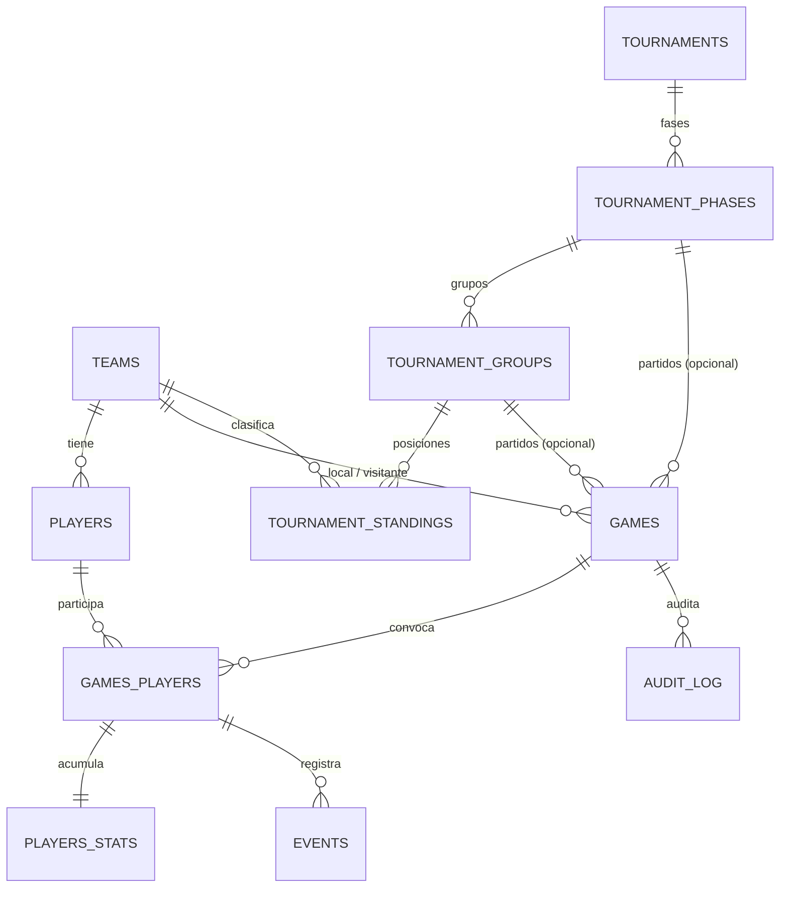

# StatsBasketball

Sistema de estadísticas de baloncesto: mesa de control en vivo para anotadores, torneos con tabla
de posiciones automática y vista pública para espectadores.

| Parte | Repo / carpeta | Stack | Despliegue |
|---|---|---|---|
| Backend | `estadisticas_backend/` (este repo) | FastAPI · SQLAlchemy · Alembic | Render |
| Frontend | `StastBasketBallFrontend` (repo aparte) | React 19 · Vite · React Query · Tailwind 3 | Vercel |
| Datos y login | Supabase | PostgreSQL (pooler 6543) · Auth | — |

```
Navegador ──(JWT de Supabase)──► FastAPI ──► PostgreSQL (Supabase)
    │                               ▲
    └── login ──► Supabase Auth ────┘  (la API valida el JWT; el navegador NO toca las tablas)
    └── /public/*  (sin login, solo lectura) ──► vista en vivo para espectadores
```

## Funcionalidades

- **Mesa de control**: titulares, reloj, anotación, faltas, cambios, cuartos, tiempo extra, deshacer.
- **Reloj autoritativo**: el servidor calcula el tiempo restante (`app/core/clock.py`); sobrevive a
  recargas, caídas de red y varios dispositivos.
- **Torneos**: fases, grupos y posiciones (victoria 2 pts, derrota 1 pt) que se actualizan solas al
  finalizar cada partido.
- **Vista pública** `/live` y `/live/:id` (frontend) sobre `/public/*` (API), sin autenticación.
- **Roles** `admin` · `scorer` · `viewer`, y **auditoría** de cada acción de la mesa.
- **Exportación** del box score en CSV.

## Torneos

- **Liga (`round_robin`)**: calendario por jornadas (método del círculo, descanso si el número es impar,
  ida y vuelta opcional). Posiciones recalculadas desde los partidos: victoria 2, derrota 1, W.O. 0;
  desempate FIBA (resultado entre empatados, diferencia, puntos a favor).
- **Playoffs (`knockout`)**: partido único, siembra estándar y pases directos (byes) a los mejores sembrados.
  El ganador avanza solo; el campeón y el estado del torneo se derivan de los partidos. Un empate no se
  puede finalizar (tiempo extra).
- **Liga + Playoffs (`league_playoffs`)**: los mejores de la tabla (`advance_count`) siembran la llave.
- Migraciones `0003` y `0004` (aplicar antes de desplegar). Código: `standings_service`, `scheduling_service`,
  `bracket_service`.

## Roles

El rol sale de `app_metadata.role` del JWT. Quien no tenga rol usa `DEFAULT_ROLE` (por defecto
`admin`, para no bloquear cuentas existentes).

| Rol | Puede |
|---|---|
| `viewer` | Solo leer |
| `scorer` | Leer + operar la mesa (eventos, deshacer, cambios, reloj, cuartos, iniciar/finalizar) |
| `admin` | Todo (equipos, jugadores, partidos, torneos, borrar, ver auditoría) |

Asignar un rol (SQL Editor de Supabase):

```sql
update auth.users
set raw_app_meta_data = coalesce(raw_app_meta_data, '{}'::jsonb) || '{"role":"scorer"}'
where email = 'anotador@ejemplo.com';
```

El usuario debe cerrar sesión y volver a entrar para que el token incluya el rol.
Las reglas están en `app/core/permissions.py` y se prueban en `tests/test_phase4.py`.

## Desarrollo local

```bash
cd estadisticas_backend
python -m venv .venv && source .venv/bin/activate      # Windows: .venv\Scripts\activate
pip install -r requirements.txt -r requirements-dev.txt
cp .env.example .env                                   # completa DATABASE_URL y SUPABASE_*
alembic upgrade head                                   # aplica las migraciones (idempotentes)
uvicorn app.main:app --reload                          # http://localhost:8000/docs
python -m pytest -q                                    # tests (SQLite en memoria, no tocan Supabase)
```

Sin Supabase a mano: `AUTH_REQUIRED=false` en `.env` (solo local; la API se niega a arrancar así
con `ENVIRONMENT=production`).

Frontend: ver el README de `StastBasketBallFrontend`.

## Variables de entorno (backend)

| Variable | Obligatoria | Descripción |
|---|---|---|
| `DATABASE_URL` | sí | Cadena de Postgres (Supabase, puerto 6543) |
| `ENVIRONMENT` | prod | `production` activa CORS estricto y prohíbe `AUTH_REQUIRED=false` |
| `ALLOWED_ORIGINS` | prod | Orígenes del frontend separados por comas |
| `SUPABASE_URL` / `SUPABASE_JWT_SECRET` | sí | Para validar el JWT (claves asimétricas / HS256) |
| `DEFAULT_ROLE` | no | Rol de usuarios sin rol (`admin` por defecto) |
| `AUTH_REQUIRED` | no | `false` solo en desarrollo |
| `SQL_ECHO` | no | `true` imprime el SQL |

## Despliegue

1. **Migraciones**: `alembic upgrade head` con `DATABASE_URL` de producción (haz respaldo antes).
2. **Render**: `render.yaml` define el servicio y `/health`. Pon las variables de arriba en el panel.
3. **Frontend en Vercel**: `VITE_API_URL`, `VITE_SUPABASE_URL`, `VITE_SUPABASE_ANON_KEY`.
4. **Cold start (plan gratuito)**: el workflow `.github/workflows/keepalive.yml` hace ping cada 10
   min si defines la variable de repositorio `BACKEND_URL`.
5. **Supabase**: las tablas se acceden solo desde la API. Revisa/cierra las políticas RLS de
   `tournaments*` y `games` para `anon`/`authenticated` (el frontend ya no las usa).

## Modelo de datos



## Endpoints clave

| Método y ruta | Rol mínimo | Qué hace |
|---|---|---|
| `POST /games/with-players` | admin | Crea partido con plantillas y stats en cero |
| `POST /games/{id}/teams/{team}/starters` | scorer | Fija los 5 titulares |
| `POST /games/{id}/start` · `/finish` | scorer | Inicia / finaliza (cobra minutos, actualiza posiciones) |
| `POST /games/{id}/clock/start` · `/clock/pause` | scorer | Reloj autoritativo en el servidor |
| `POST /games/{id}/end-quarter` · `/overtime` | scorer | Cambio de periodo / tiempo extra |
| `POST /events/` · `DELETE /events/{id}` | scorer | Registrar / deshacer una acción |
| `GET /games/{id}/box-score.csv` | viewer | Exporta el box score |
| `POST /tournaments/{id}/phases/{fase}/generate` | admin | Genera el calendario de liga o la llave de playoffs de la fase |
| `POST /games/{id}/forfeit` | admin | W.O.: el rival gana 20-0, el ausente suma 0 puntos |
| `GET /audit/?game_id=` | admin | Historial de acciones |
| `GET /public/games` · `/public/games/{id}/live` | **público** | Vista de espectadores |
| `GET /health` | **público** | Health check |

Documentación interactiva: `/docs` (OpenAPI).

## CI

- Backend: `.github/workflows/backend-ci.yml` (ruff, pytest, migración Alembic).
- Frontend: workflow propio en su repo (tests + build).
