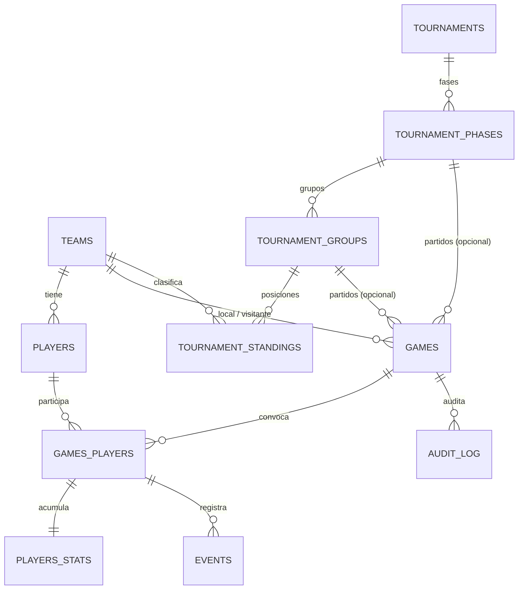

# StatsBasketball

Sistema de estadísticas de baloncesto: mesa de control en vivo para anotadores, torneos con tabla
de posiciones automática y vista pública para espectadores.

| Parte | Repo / carpeta | Stack | Despliegue |
|---|---|---|---|
| Backend | `estadisticas_backend/` (este repo) | FastAPI · SQLAlchemy · Alembic | Render |
| Frontend | `StastBasketBallFrontend` (repo aparte) | React 19 · Vite · React Query · Tailwind 3 | Vercel |
| Datos y login | Supabase | PostgreSQL (pooler 6543) · Auth | — |

```
Navegador ──(JWT de Supabase)──► FastAPI ──► PostgreSQL (Supabase)
    │                               ▲
    └── login ──► Supabase Auth ────┘  (la API valida el JWT; el navegador NO toca las tablas)
    └── /public/*  (sin login, solo lectura) ──► vista en vivo para espectadores
```

## Funcionalidades

- **Mesa de control**: titulares, reloj, anotación, faltas, cambios, cuartos, tiempo extra, deshacer.
- **Reloj autoritativo**: el servidor calcula el tiempo restante (`app/core/clock.py`); sobrevive a
  recargas, caídas de red y varios dispositivos.
- **Torneos**: fases, grupos y posiciones (victoria 2 pts, derrota 1 pt) que se actualizan solas al
  finalizar cada partido.
- **Vista pública** `/live` y `/live/:id` (frontend) sobre `/public/*` (API), sin autenticación.
- **Roles** `admin` · `scorer` · `viewer`, y **auditoría** de cada acción de la mesa.
- **Exportación** del box score en CSV.

## Torneos

- **Liga (`round_robin`)**: calendario por jornadas (método del círculo, descanso si el número es impar,
  ida y vuelta opcional). Posiciones recalculadas desde los partidos: victoria 2, derrota 1, W.O. 0;
  desempate FIBA (resultado entre empatados, diferencia, puntos a favor).
- **Playoffs (`knockout`)**: partido único, siembra estándar y pases directos (byes) a los mejores sembrados.
  El ganador avanza solo; el campeón y el estado del torneo se derivan de los partidos. Un empate no se
  puede finalizar (tiempo extra).
- **Liga + Playoffs (`league_playoffs`)**: los mejores de la tabla (`advance_count`) siembran la llave.
- **Agenda de equipos**: al crear, mover o generar partidos se valida que ningún equipo juegue con menos de 3 h
  entre inicios ni más de 2 partidos al día (referencia: manual Youth EuroBasket de FIBA y guías juveniles
  NBA/USA Basketball); si no se cumple, la API responde 409 con el choque exacto.
- **Partidos atrasados**: un partido programado cuya hora pasó (más la gracia) y no se inició se marca `is_overdue`
  (no cambia su estado). El admin decide: iniciarlo tarde, reprogramarlo, declarar W.O. (torneo) o cancelarlo
  (solo amistosos). `games.started_at` / `finished_at` guardan la hora real de inicio y fin.
- **Inicio anticipado**: iniciar un partido más de 15 min antes de su hora responde 409 `early_start`; al confirmar
  (`adjust_date`) su fecha pasa a ser ahora, se valida la agenda de ambos equipos y queda en la auditoría.
- **Mesa de control**: solo se anotan o deshacen acciones con el partido en juego; faltas técnicas y
  antideportivas (suman falta personal y de equipo; 2 de ellas = descalificación), rebotes ofensivos/defensivos,
  tiempos muertos y bitácora (migración `0006`).
- **Equipos y jugadores**: perfil opcional del equipo (nombre corto, colores, categoría, ciudad, entrenador, escudo) y del
  jugador (posición, capitán, estatura, nacimiento, foto). El nombre del equipo es único; el dorsal es único por equipo
  (se valida en la API: puede haber repetidos antiguos) y hay un solo capitán por equipo (migración `0008`).
- **Jugadores**: edad entre 6 y 80 años si se informa la fecha de nacimiento (constantes `MIN_AGE`/`MAX_AGE`).
  Tiempos muertos FIBA incluyendo máximo 2 por equipo en los últimos 2 minutos del 4.º periodo.
- Migraciones `0003` y `0004` (aplicar antes de desplegar). Código: `standings_service`, `scheduling_service`,
  `bracket_service`.

## Roles

El rol sale de `app_metadata.role` del JWT. Quien no tenga rol usa `DEFAULT_ROLE` (por defecto
`admin`, para no bloquear cuentas existentes).

| Rol | Puede |
|---|---|
| `viewer` | Solo leer |
| `scorer` | Leer + operar la mesa (eventos, deshacer, cambios, reloj, cuartos, iniciar/finalizar) |
| `admin` | Todo (equipos, jugadores, partidos, torneos, borrar, ver auditoría) |

Asignar un rol (SQL Editor de Supabase):

```sql
update auth.users
set raw_app_meta_data = coalesce(raw_app_meta_data, '{}'::jsonb) || '{"role":"scorer"}'
where email = 'anotador@ejemplo.com';
```

El usuario debe cerrar sesión y volver a entrar para que el token incluya el rol.
Las reglas están en `app/core/permissions.py` y se prueban en `tests/test_phase4.py`.

## Desarrollo local

```bash
cd estadisticas_backend
python -m venv .venv && source .venv/bin/activate      # Windows: .venv\Scripts\activate
pip install -r requirements.txt -r requirements-dev.txt
cp .env.example .env                                   # completa DATABASE_URL y SUPABASE_*
alembic upgrade head                                   # aplica las migraciones (idempotentes)
uvicorn app.main:app --reload                          # http://localhost:8000/docs
python -m pytest -q                                    # tests (SQLite en memoria, no tocan Supabase)
```

Sin Supabase a mano: `AUTH_REQUIRED=false` en `.env` (solo local; la API se niega a arrancar así
con `ENVIRONMENT=production`).

Frontend: ver el README de `StastBasketBallFrontend`.

## Variables de entorno (backend)

| Variable | Obligatoria | Descripción |
|---|---|---|
| `DATABASE_URL` | sí | Cadena de Postgres (Supabase, puerto 6543) |
| `ENVIRONMENT` | prod | `production` activa CORS estricto y prohíbe `AUTH_REQUIRED=false` |
| `ALLOWED_ORIGINS` | prod | Orígenes del frontend separados por comas |
| `SUPABASE_URL` / `SUPABASE_JWT_SECRET` | sí | Para validar el JWT (claves asimétricas / HS256) |
| `DEFAULT_ROLE` | no | Rol de usuarios sin rol (`admin` por defecto) |
| `AUTH_REQUIRED` | no | `false` solo en desarrollo |
| `SQL_ECHO` | no | `true` imprime el SQL |
| `SUPABASE_SERVICE_ROLE_KEY` | para escudos/fotos | Clave de servidor de Supabase (**secreta**, solo en el servidor): la nueva *secret key* (`sb_secret_...`, Settings → API Keys) o la antigua `service_role` (pestaña Legacy API Keys). Sin ella la subida responde 503 |
| `STORAGE_BUCKET` | no | Bucket público de Supabase Storage para escudos y fotos (`team-assets` por defecto) |
| `MIN_REST_MINUTES` | no | Descanso mínimo entre partidos de un mismo equipo, en minutos (180 por defecto) |
| `EARLY_START_TOLERANCE_MINUTES` | no | Antelación (min) a partir de la cual iniciar un partido pide confirmación y mueve su fecha a ahora (15 por defecto) |
| `OVERDUE_GRACE_MINUTES` | no | Minutos tras la hora programada para marcar un partido como atrasado (30 por defecto) |
| `MAX_GAMES_PER_DAY` | no | Máximo de partidos por equipo al día (2 por defecto) |

## Despliegue

1. **Migraciones**: `alembic upgrade head` con `DATABASE_URL` de producción (haz respaldo antes).
2. **Render**: `render.yaml` define el servicio y `/health`. Pon las variables de arriba en el panel.
3. **Frontend en Vercel**: `VITE_API_URL`, `VITE_SUPABASE_URL`, `VITE_SUPABASE_ANON_KEY`.
4. **Cold start (plan gratuito)**: el workflow `.github/workflows/keepalive.yml` hace ping cada 10
   min si defines la variable de repositorio `BACKEND_URL`.
5. **Supabase**: las tablas se acceden solo desde la API. Revisa/cierra las políticas RLS de
   `tournaments*` y `games` para `anon`/`authenticated` (el frontend ya no las usa).

## Modelo de datos



## Endpoints clave

| Método y ruta | Rol mínimo | Qué hace |
|---|---|---|
| `POST /games/with-players` | admin | Crea partido con plantillas y stats en cero |
| `POST /games/{id}/teams/{team}/starters` | scorer | Fija los 5 titulares |
| `POST /games/{id}/start` · `/finish` | scorer | Inicia / finaliza (cobra minutos, actualiza posiciones) |
| `POST /games/{id}/clock/start` · `/clock/pause` | scorer | Reloj autoritativo en el servidor |
| `POST /games/{id}/end-quarter` · `/overtime` | scorer | Cambio de periodo / tiempo extra |
| `POST /events/` · `DELETE /events/{id}` | scorer | Registrar / deshacer una acción |
| `GET /games/{id}/box-score.csv` | viewer | Exporta el box score |
| `POST /tournaments/{id}/phases/{fase}/generate` | admin | Genera el calendario de liga o la llave de playoffs de la fase |
| `POST /games/{id}/timeouts` · `DELETE /games/{id}/timeouts/{tid}` | scorer | Tiempo muerto (FIBA: 2 en la 1.ª mitad, 3 en la 2.ª, 1 por prórroga); pausa el reloj |
| `GET /events/game/{id}` | viewer | Bitácora jugada a jugada |
| `PUT/DELETE /teams/{id}/logo` · `PUT/DELETE /players/{id}/photo` | admin | Escudo/foto: cuerpo binario PNG, JPG o WebP (máx. 1 MB; el navegador la reduce a 256 px). Se guarda en Supabase Storage |
| `POST /games/{id}/cancel` | admin | Cancela un amistoso programado, o lo **suspende** si está en juego y no puede terminar (empatado); reprogramarlo lo reactiva. Los de torneo no se cancelan |
| `PUT /games/{id}/possession` | scorer | Flecha de posesión alterna (equipo que obtiene el próximo balón retenido) |
| `GET/POST /users`, `PATCH/DELETE /users/{id}`, `POST /users/{id}/password` | admin | Gestión de usuarios (anotadores y administradores) vía Supabase Auth. Reglas: el administrador supremo (`app_metadata.super_admin`) no se elimina, desactiva ni degrada; solo él crea/promueve/degrada admins; nadie actúa sobre su propia cuenta; siempre queda un admin activo |
| `POST /games/{id}/forfeit` | admin | W.O.: el rival gana 20-0, el ausente suma 0 puntos |
| `GET /audit/?game_id=` | admin | Historial de acciones |
| `GET /public/games` · `/public/games/{id}/live` | **público** | Vista de espectadores |
| `GET /health` | **público** | Health check |

Documentación interactiva: `/docs` (OpenAPI).

## CI

- Backend: `.github/workflows/backend-ci.yml` (ruff, pytest, migración Alembic).
- Frontend: workflow propio en su repo (tests + build).


## Usuarios y roles

- **Administrador supremo**: cuenta de rescate, marcada con `app_metadata.super_admin = true`. Se marca una sola vez con SQL en Supabase:

  ```sql
  update auth.users
     set raw_app_meta_data = raw_app_meta_data || '{"role":"admin","super_admin":true}'
   where email = 'tu-correo';
  ```
  Después hay que cerrar sesión y volver a entrar para que el token traiga la marca.
- **Administradores**: todo el mando operativo; los promueve solo el supremo.
- **Anotadores**: solo la mesa de control; los crea cualquier administrador desde la pantalla **Usuarios**.
- **Público**: no tiene cuenta; consulta `/live` (y el sitio público).
- `DEFAULT_ROLE=viewer` en producción para que una cuenta sin rol nunca tenga poder. Hacerlo **después** de marcar al supremo.
- Desactivar, eliminar o cambiar el rol surte efecto de inmediato (`app/core/revocation.py`), sin esperar a que caduque el token.
- Requiere `SUPABASE_SERVICE_ROLE_KEY` (la misma de las imágenes).


## Sitio público (sin cuenta)

Rutas de solo lectura bajo `/public`, sin autenticación y con límite de 240 peticiones por minuto y por IP
(`app/core/ratelimit.py`): `/public/games`, `/public/games/{id}/live`, `/public/games/{id}/summary` (solo partidos
terminados), `/public/teams`, `/public/teams/{id}`, `/public/players/{id}`, `/public/tournaments`,
`/public/tournaments/{id}` y `/public/leaders`.

**Privacidad:** del jugador se publica la **edad**, nunca la fecha de nacimiento (hay una prueba que revisa todas las
respuestas públicas). Nada de auditoría, usuarios ni datos de gestión.


## Actividad (solo administrador supremo)

`GET /audit/activity` lista los movimientos de **todos** los usuarios (filtros: `user`, `group`, `since`, `until`, paginación).
Solo responde al administrador supremo; el historial por partido (`GET /audit/?game_id=`) sigue siendo para cualquier admin.

La auditoría registra: eventos y acciones de la mesa de control, crear/editar/borrar equipos, jugadores y partidos,
reprogramar/cancelar/W.O., torneos (crear y generar), cambios manuales de estadísticas y la gestión de usuarios.
Al borrar se guarda el nombre (o los equipos del partido) para que el movimiento siga siendo legible.
Las fechas se filtran por día de Colombia (UTC-5).


## Home del staff

`GET /dashboard/` (cualquier usuario con sesión): partidos en juego, próximos, conteos y, **solo para administradores**,
los últimos resultados (`recent`), los torneos activos con su avance, el top de la tabla y el próximo partido (`tournaments`) y, solo para administradores, las alertas que requieren atención (`attention`): partidos atrasados, amistosos suspendidos con marcador, equipos con menos
de 5 jugadores, dorsales repetidos y torneos con fases sin partidos. El anotador recibe `attention: null`.

`GET /dashboard/` también devuelve `performance` (totales de partidos jugados y puntos, partidos por semana de las últimas 8
semanas y líderes por promedio; los W.O. no cuentan) y, **solo para el administrador supremo**, `activity` (los últimos
movimientos de todos los usuarios; el detalle completo está en `GET /audit/activity`).
